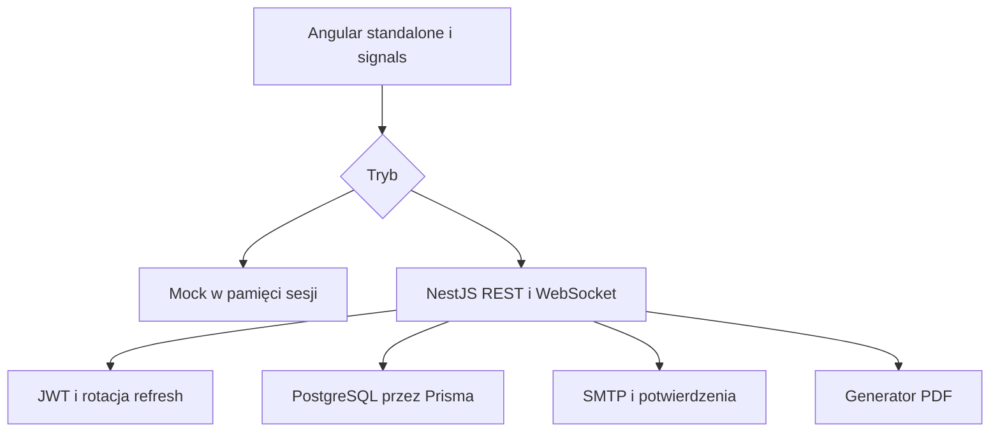
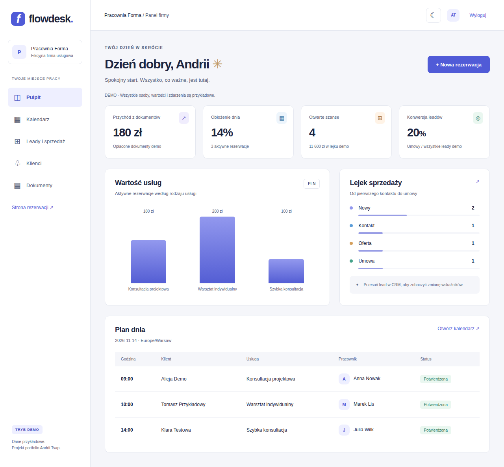
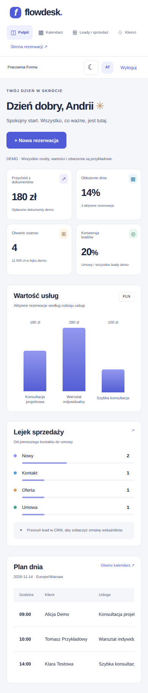

Projekt koncepcyjny do portfolio – fikcyjna marka

# FlowDesk

System rezerwacji i CRM dla fikcyjnej Pracowni Forma. Autor: **Andrii Tsap**.

## Problem → rozwiązanie

Terminy, kontakty i dokumenty rozproszone w kilku narzędziach utrudniają obsługę małej firmy. FlowDesk zbiera rezerwacje, klientów, szanse sprzedaży i podsumowania w jednym panelu. Dane demo są fikcyjne — nie przedstawiają rzeczywistych klientów ani wyników.

## Funkcje

- Publiczne rezerwacje: usługi, pracownicy, dostępne godziny, przerwa, strefa Europe/Warsaw, blokada kolizji.
- Kalendarz i anulowanie rezerwacji; CRM Kanban z drag & drop oraz dostępną alternatywą klawiaturową.
- Klienci i historia wizyt, eksport CSV z ochroną przed formułami.
- Dashboard i wykresy danych przykładowych; PDF ofert/dokumentów demonstracyjnych; tryb ciemny.
- Osadzany widget FAQ zbierający leady.
- API NestJS: PostgreSQL/Prisma, JWT 15 min, rotowane tokeny refresh w HttpOnly cookie, role admin/pracownik/klient, Swagger, walidacja, Helmet, limity żądań, SMTP, WebSocket.
- Blokada równoległych rezerwacji w PostgreSQL: exclusion constraint + transakcja Serializable.

## Architektura



## Technologie

Angular 22.2.6, TypeScript 6, Angular Material/CDK, NestJS 11, PostgreSQL 17, Prisma 6, Socket.IO, Nodemailer, PDFKit/jsPDF, Vitest 4, Playwright, Docker. Wersje zablokowane w `package-lock.json`.

## Uruchomienie lokalne

1. Node.js 24 i Docker Compose.
2. `cp .env.example .env`. Ustaw losowe `POSTGRES_PASSWORD`, `JWT_SECRET` (32+ znaków), `ADMIN_PASSWORD` (12+ znaków) oraz `ADMIN_EMAIL`.
3. `docker compose up --build` — panel http://localhost:4200, API http://localhost:3001/api, Swagger http://localhost:3001/api/docs, podgląd poczty http://localhost:8025.
4. W pełnym stosie loguj się danymi administratora z `.env`. `demo/demo123` działa wyłącznie w statycznym demo.
5. Sam frontend: `npm ci && npm run dev`. Domyślnie działa niezależnie od API.
6. `npm run lint && npm test && npm run build`; `npx playwright install chromium && npm run test:e2e`.

## Deployment

GitHub Pages: Source = GitHub Actions. Workflow publikuje `dist/web/browser` z base href `/flowdesk/`; routing hash działa po odświeżeniu każdej podstrony.

Render: New Blueprint → to repozytorium → `render.yaml`. Ustaw ADMIN_EMAIL, ADMIN_PASSWORD i FRONTEND_URL (dokładny origin bez ścieżki, np. https://andriu-tsap.github.io) oraz SMTP. API uruchamia migracje i idempotentny seed. W `apps/web/public/config.json` ustaw `demo:false` i URL API, aby zbudować wersję połączoną z backendem. Publiczne portfolio pozostaje w trybie demo.

Bezpłatny PostgreSQL Render wygasa po 30 dniach; bezpłatna usługa może zasypiać. To hosting do testów, nie obietnica bezterminowej bazy produkcyjnej. Źródło: https://render.com/docs/free (sprawdzone 14.11.2026).

## Widget

```html
<iframe
  src="https://andriu-tsap.github.io/flowdesk/#/widget"
  title="FlowDesk — pomoc i kontakt"
  width="400"
  height="650"
  style="max-width:100%;border:0"
></iframe>
```

## Demo

https://andriu-tsap.github.io/flowdesk/ — login **demo**, hasło **demo123**. Po odświeżeniu dane demo wracają do stanu początkowego. Nie wysyłamy wiadomości ani prawdziwych dokumentów księgowych.

## Jakość

CI: lint, unit, kompilacja frontend/backend, migracje prawdziwego PostgreSQL, testy API (role, równoległe rezerwacje, rotacja i ponowne użycie refresh), Playwright desktop/mobile, mobilny Lighthouse.

<!-- LIGHTHOUSE -->

Lighthouse: oczekuje na pomiar CI.
<!-- /LIGHTHOUSE -->

## Zrzuty




## Granice zastosowania

Dokumenty PDF to przykładowe podsumowania, nie system księgowy. Przed wdrożeniem komercyjnym skonfiguruj politykę retencji, kopie zapasowe, dostarczalność e-maili i monitorowanie. Role są egzekwowane na API; konta pracowników i klientów tworzy administrator w bazie, brak publicznej rejestracji. Godziny pracy domyślnie 09–17, przerwa 12–13, niedziela wolna.
